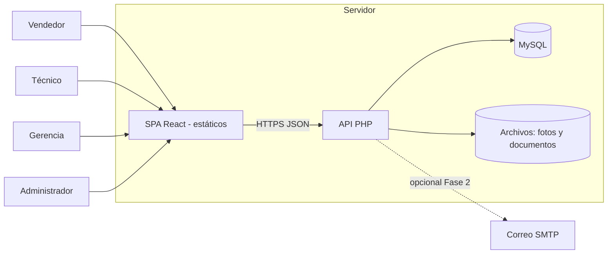
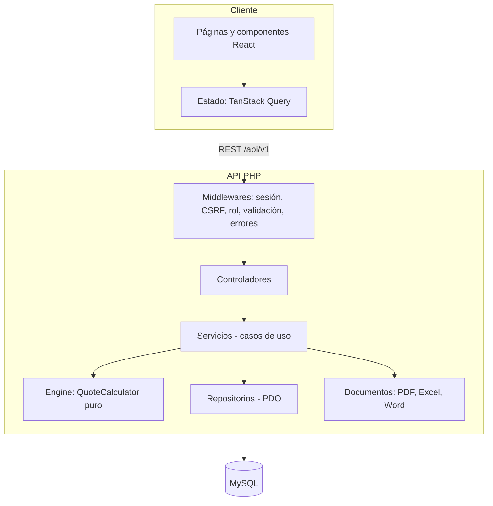

# Documento de Arquitectura de Software

**Versión:** 1.0 · 17 de octubre de 2026
**Alcance:** aplicación web interna de proformas (8 a 20 usuarios, 15 a 20 proformas al mes).
**Principio rector:** *la solución más simple que proteja el cálculo del dinero*, barata de alojar y fácil de mantener por una IA y por una persona.

---

## 1. Resumen y decisiones clave

| Decisión | Elección | Razón |
|---|---|---|
| Patrón | **Monolito modular por capas**: API REST + SPA | Volumen bajo; un solo despliegue; menos piezas que fallar |
| Backend | **PHP 8.2+ puro (sin framework full-stack)** | Decisión del responsable; hosting económico |
| Frontend | **React + Vite + TypeScript (SPA)** | Decisión del responsable; experiencia responsive |
| Base de datos | **MySQL 8 / MariaDB** | Disponible en hosting compartido; ya usado por el responsable |
| Reglas de negocio | **Motor de cálculo puro** en el backend, sin E/S | Probable al 100 % con pruebas; un solo resultado en pantalla, PDF y Excel |
| Dinero | Enteros en céntimos o BCMath; columnas `DECIMAL(12,2)` | Sin errores de punto flotante |
| Autenticación | Sesión de servidor con cookie segura | Más simple y segura que JWT para una app interna |
| Documentos | Dompdf (PDF), PhpSpreadsheet (Excel), PHPWord (Word) | Funcionan en hosting compartido |
| Hosting | Hosting compartido con cPanel o VPS pequeño | Costo bajo (ver sección 6) |

## 2. Contexto del sistema



No hay integraciones externas obligatorias en el MVP. El tipo de cambio y los precios de proveedores se registran manualmente o por importación de Excel.

## 3. Arquitectura lógica



### Capas y responsabilidades

| Capa | Responsabilidad | Prohibido |
|---|---|---|
| **Http** (controladores, middlewares, requests, resources) | Entrada/salida, validación, permisos, DTO por rol | Reglas de negocio, SQL |
| **Services** | Casos de uso: crear proforma, emitir, aprobar | Acceso HTTP directo |
| **Engine** | Cálculo de costos, horas, días, margen e IGV | Acceso a base de datos, HTTP, fecha actual implícita |
| **Repositories** | Consultas con PDO y sentencias preparadas | Reglas de negocio |
| **Domain** | Objetos de valor (`Money`, `Hours`), entidades | Dependencia de infraestructura |
| **Documents** | Generación de PDF, Excel y Word desde un resultado de cálculo ya congelado | Recalcular importes |

### Regla de oro del dinero
Los documentos y la pantalla **leen** los totales calculados por el motor y guardados en el congelado de la proforma. Nadie recalcula en React ni en las plantillas.

## 4. Stack tecnológico

| Capa | Tecnología | Versión objetivo | Notas |
|---|---|---|---|
| Lenguaje backend | PHP | 8.2 o superior | `declare(strict_types=1)` en todo archivo |
| Router | `nikic/fast-route` | estable | Punto único `public/index.php` |
| Acceso a datos | PDO (MySQL) | — | Solo sentencias preparadas |
| Configuración | `vlucas/phpdotenv` | estable | `.env` fuera del repositorio |
| Cálculo decimal | BCMath (o `brick/math`) | — | Mitad hacia arriba |
| PDF | `dompdf/dompdf` | estable | HTML + CSS propios |
| Excel | `phpoffice/phpspreadsheet` | estable | Hoja cliente + hoja interna |
| Word | `phpoffice/phpword` | estable | Fase 2 |
| Pruebas backend | PHPUnit | estable | Motor ≥ 95 % de cobertura |
| Análisis estático | PHPStan | nivel 6 o superior | En CI |
| Estilo | PHP_CodeSniffer (PSR-12) | — | En CI |
| Frontend | React + Vite + TypeScript | React 18 o superior | PWA |
| Datos del servidor | TanStack Query | — | Caché y reintentos |
| Rutas | React Router | — | — |
| Pruebas frontend | Vitest + React Testing Library | — | Componentes críticos |
| Calidad frontend | ESLint + Prettier | — | En CI |
| Base de datos | MySQL 8 / MariaDB 10.6+ | — | `utf8mb4`, motor InnoDB |
| Control de versiones | Git | — | Ramas `main` y `develop` |
| CI/CD | GitHub Actions | — | Ver documento 11 |

## 5. Patrones y convenciones

- **API REST JSON** versionada (`/api/v1`), códigos HTTP estándar y errores uniformes `{ "code", "message", "details" }`.
- **DTO por rol:** controladores devuelven `Resource` distintos para vendedor, técnico y gerencia/administrador.
- **Snapshot inmutable:** al emitir, se guarda un JSON con precios, tipo de cambio, parámetros, horas y totales; los documentos se generan desde ese JSON.
- **Idempotencia y concurrencia:** el correlativo `PF-AAAA-NNNN` usa una tabla de secuencias con bloqueo de fila (`SELECT … FOR UPDATE`).
- **Auditoría:** una bitácora de solo inserción registra cambios de precios, parámetros, descuentos, aprobaciones y estados.
- **Migraciones SQL versionadas** (`NNN_descripcion.sql`), solo hacia adelante, compatibles con la versión anterior del código (ver documento 11).
- **Validación en servidor** para toda entrada; la validación del frontend es solo ayuda de usabilidad.
- **Sin lógica en el frontend** para importes: React muestra lo que devuelve `POST /quotes/:id/calculate`.

## 6. Estrategia de hosting

| Opción | Características | Cuándo conviene | Costo relativo |
|---|---|---|---|
| **A. Hosting compartido con cPanel** (recomendada para arrancar) | PHP 8.2, MySQL, SSL, cron, copias del proveedor | Un solo negocio, bajo volumen, equipo sin DevOps | Bajo |
| **B. VPS pequeño** (1–2 vCPU, 2 GB RAM) | Control total, despliegue por SSH, symlink de releases | Si se necesita más control o fotos pesadas | Medio |
| **C. Contenedores en nube administrada** | Escalado y despliegues avanzados | Solo si crece mucho | Alto |

**Recomendación:** comenzar con **A**, diseñando el código para poder mudarse a **B** sin cambios (configuración por variables de entorno, rutas relativas, sin dependencias del panel).

### Requisitos del hosting
- PHP 8.2+ con extensiones `pdo_mysql`, `mbstring`, `gd`, `zip`, `xml`, `bcmath`, `intl`.
- Certificado SSL y redirección forzada a HTTPS.
- Cron para tareas programadas (vencimiento de proformas, copias, recordatorios).
- Acceso SSH o Git en el panel (si no hay SSH, despliegue por FTP/SFTP automatizado).
- Copia automática de base de datos y archivos.

### Estructura en el servidor

```
/home/usuario/
  proformas_api/            # código de la API (fuera de public_html)
    src/ vendor/ migrations/ storage/ .env
  public_html/
    api/                    # public/ de la API (index.php, .htaccess)
    index.html, assets/     # SPA compilada
  backups/                  # copias locales temporales
```

## 7. Configuración de entornos

| Entorno | Propósito | Datos | URL ejemplo | Quién despliega |
|---|---|---|---|---|
| **Local** | Desarrollo (XAMPP o Docker) | Datos de prueba (seed) | `http://localhost` | Desarrollador / IA |
| **Pruebas (staging)** | Validación con usuarios y cálculos reales | Copia anonimizada o datos de prueba | `https://pruebas.dominio.pe` | CI automático al fusionar en `develop` |
| **Producción** | Uso real | Datos reales | `https://proformas.dominio.pe` | CI con aprobación manual sobre `main` |

### Variables de entorno (`.env`)

| Variable | Descripción | Ejemplo |
|---|---|---|
| `APP_ENV` | Entorno | `production` |
| `APP_DEBUG` | Mostrar errores | `false` en producción |
| `APP_URL` | URL pública | `https://proformas.dominio.pe` |
| `DB_HOST`, `DB_PORT`, `DB_NAME`, `DB_USER`, `DB_PASS` | Conexión MySQL | — |
| `SESSION_LIFETIME` | Minutos de inactividad | `30` |
| `CORS_ORIGIN` | Origen permitido del frontend | `https://proformas.dominio.pe` |
| `STORAGE_PATH` | Carpeta de fotos y documentos | `/home/usuario/proformas_api/storage` |
| `MAIL_*` | SMTP (Fase 2) | — |
| `TZ` | Zona horaria | `America/Lima` |

Los secretos (`.env`, claves) **no se versionan**. Cada entorno tiene su propia base de datos y credenciales.

## 8. Seguridad

| Área | Medida |
|---|---|
| Autenticación | `password_hash` (argon2id o bcrypt); bloqueo tras 5 intentos; sesión con cookie `HttpOnly`, `Secure`, `SameSite=Lax`; regeneración del ID de sesión al iniciar |
| Autorización | Middleware por rol en cada ruta; DTO por rol; pruebas automáticas por endpoint |
| Datos | Sentencias preparadas; validación de tipos y rangos; escape de salida |
| Web | HTTPS obligatorio; cabeceras (`Content-Security-Policy`, `X-Content-Type-Options`, `Referrer-Policy`); token CSRF en operaciones de escritura |
| Archivos | Tipo MIME real, tamaño máximo, nombres aleatorios, carpeta fuera de la raíz pública |
| Errores | `display_errors=Off` en producción; registro en archivo; sin trazas hacia el cliente |
| Privacidad | Acceso mínimo necesario; datos de clientes conforme a la normativa peruana de protección de datos (validar con asesoría) |
| Respaldo | Copia diaria cifrada, retención de 14 días, restauración probada |

## 9. Rendimiento y capacidad

- El cálculo de una proforma de 50 líneas debe completarse en ≤ 2 s.
- Índices por claves foráneas, estado, fecha y número de proforma.
- Caché de lectura en memoria del navegador (TanStack Query); sin caché de servidor en el MVP.
- Generación de PDF síncrona (≤ 5 s); si crece, pasar a cola.
- Capacidad objetivo: 20 usuarios y 1,000 proformas al año sin cambios de infraestructura.

## 10. Observabilidad y operación

| Aspecto | Solución |
|---|---|
| Registro de errores | Archivo de log rotado en `storage/logs` |
| Alertas | Correo al administrador ante errores críticos y fallas de copia |
| Salud | Endpoint `GET /api/v1/health` (estado de API y base de datos) |
| Métricas de negocio | Panel de indicadores de éxito (tiempo de cotización, correcciones, margen, adopción) |
| Tareas programadas | Cron diario: vencimiento de proformas, copia de seguridad, limpieza de sesiones |

## 11. Registro de decisiones de arquitectura (ADR)

| ID | Decisión | Alternativas | Motivo |
|---|---|---|---|
| ADR-01 | PHP puro sin framework | Laravel, Slim | Restricción del responsable; pocas dependencias |
| ADR-02 | Monolito modular | Microservicios | Volumen bajo; simplicidad |
| ADR-03 | Sesión de servidor con cookie | JWT | App interna; más fácil de revocar y asegurar |
| ADR-04 | Motor de cálculo puro | Cálculo en SQL o en frontend | Pruebas exhaustivas; resultado único |
| ADR-05 | Snapshot JSON al emitir | Recalcular al abrir | Inmutabilidad; auditoría |
| ADR-06 | Dinero en `DECIMAL(12,2)` + BCMath | `FLOAT` | Evita errores de redondeo |
| ADR-07 | MySQL 8 | PostgreSQL | Hosting compartido; experiencia del equipo |
| ADR-08 | PDF con Dompdf | Navegador sin cabeza | Compatible con hosting compartido |
| ADR-09 | Migraciones SQL propias | ORM completo | Control y simplicidad |

## 12. Riesgos técnicos

| Riesgo | Mitigación |
|---|---|
| Errores de cálculo introducidos por el desarrollo con IA | Motor aislado, pruebas con casos del documento de QA, revisión humana de los resultados |
| Limitaciones del hosting compartido (memoria, tiempo de ejecución en PDF) | Plantillas livianas; límite de líneas; ruta de migración a VPS |
| Pérdida de datos | Copias diarias, restauración probada |
| Dependencia de un solo desarrollador/IA | Documentación (este conjunto), pruebas automáticas y estándares de código |
