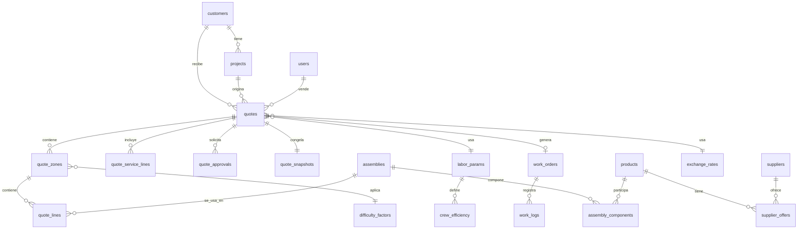

# Diccionario de Datos

**Versión:** 1.0 · 17 de octubre de 2026
**Motor:** MySQL 8 / MariaDB 10.6+ · InnoDB · `utf8mb4` / `utf8mb4_unicode_ci` · zona horaria de aplicación `America/Lima` (los `DATETIME` se guardan en UTC).

## Convenciones

| Convención | Detalle |
|---|---|
| Nombres | Tablas y columnas en inglés, `snake_case`, tablas en plural |
| Llaves primarias | `id BIGINT UNSIGNED AUTO_INCREMENT` |
| Dinero | `DECIMAL(12,2)` en soles (PEN); costos originales en su moneda en `supplier_offers` |
| Horas y cantidades | Horas `DECIMAL(6,2)`; porcentajes `DECIMAL(5,2)` (30.00 = 30 %); factores `DECIMAL(4,2)` |
| Fechas | `created_at`, `updated_at` (`DATETIME`) en todas las tablas salvo indicación |
| Borrado | Lógico (`is_active` o `deleted_at`) en tablas maestras; nunca se borra lo usado en proformas |
| Llaves | PK = llave primaria, FK = foránea, UK = única, IDX = índice |
| Fase | **MVP** salvo que se indique **F2** |

---

## 1. Seguridad y auditoría

### `users` — Usuarios del sistema (MVP)

| Columna | Tipo | Llave | Restricciones | Descripción |
|---|---|---|---|---|
| id | BIGINT UNSIGNED | PK | AUTO_INCREMENT | Identificador |
| name | VARCHAR(120) | | NOT NULL | Nombre completo |
| email | VARCHAR(160) | UK | NOT NULL | Correo de acceso |
| password_hash | VARCHAR(255) | | NOT NULL | Hash argon2id o bcrypt |
| role | ENUM('vendedor','tecnico','gerencia','admin') | IDX | NOT NULL | Rol único del usuario |
| is_active | TINYINT(1) | | NOT NULL, DEFAULT 1 | Usuario activo |
| failed_attempts | TINYINT UNSIGNED | | NOT NULL, DEFAULT 0 | Intentos fallidos seguidos |
| locked_until | DATETIME | | NULL | Bloqueo temporal hasta |
| last_login_at | DATETIME | | NULL | Último acceso |
| max_discount_pct | DECIMAL(5,2) | | NULL | Tope de descuento propio (NULL = usa el general) |
| created_at / updated_at | DATETIME | | NOT NULL | Control |

### `password_resets` — Restablecimiento de contraseña (Should)

| Columna | Tipo | Llave | Restricciones | Descripción |
|---|---|---|---|---|
| id | BIGINT UNSIGNED | PK | AUTO_INCREMENT | Identificador |
| user_id | BIGINT UNSIGNED | FK → users.id | NOT NULL, ON DELETE CASCADE | Usuario |
| token_hash | CHAR(64) | UK | NOT NULL | Hash SHA-256 del token |
| expires_at | DATETIME | | NOT NULL | Vencimiento (1 hora) |
| used_at | DATETIME | | NULL | Fecha de uso (un solo uso) |
| created_at | DATETIME | | NOT NULL | Creación |

### `audit_log` — Bitácora de cambios sensibles (solo inserción)

| Columna | Tipo | Llave | Restricciones | Descripción |
|---|---|---|---|---|
| id | BIGINT UNSIGNED | PK | AUTO_INCREMENT | Identificador |
| user_id | BIGINT UNSIGNED | FK → users.id | NULL | Quién hizo el cambio |
| entity | VARCHAR(60) | IDX | NOT NULL | Tabla o entidad afectada |
| entity_id | BIGINT UNSIGNED | IDX | NOT NULL | Registro afectado |
| action | VARCHAR(40) | | NOT NULL | `create`, `update`, `delete`, `approve`, `reject`, `issue`, `status_change` |
| old_values | JSON | | NULL | Valores anteriores |
| new_values | JSON | | NULL | Valores nuevos |
| ip_address | VARCHAR(45) | | NULL | IP de origen |
| created_at | DATETIME | IDX | NOT NULL | Fecha del cambio |

---

## 2. Clientes y proyectos

### `customers` — Clientes (MVP)

| Columna | Tipo | Llave | Restricciones | Descripción |
|---|---|---|---|---|
| id | BIGINT UNSIGNED | PK | AUTO_INCREMENT | Identificador |
| document_type | ENUM('RUC','DNI','CE','OTRO') | | NOT NULL | Tipo de documento |
| document_number | VARCHAR(15) | UK (con document_type) | NOT NULL | RUC 11 dígitos, DNI 8 |
| name | VARCHAR(160) | IDX | NOT NULL | Nombre o razón social |
| email | VARCHAR(160) | | NULL | Correo de contacto |
| phone | VARCHAR(30) | | NULL | Teléfono |
| contact_name | VARCHAR(120) | | NULL | Persona de contacto |
| address | VARCHAR(255) | | NULL | Dirección fiscal |
| is_active | TINYINT(1) | | NOT NULL, DEFAULT 1 | Activo |
| created_by | BIGINT UNSIGNED | FK → users.id | NOT NULL | Creador |
| created_at / updated_at | DATETIME | | NOT NULL | Control |

### `projects` — Obras o proyectos de un cliente (MVP)

| Columna | Tipo | Llave | Restricciones | Descripción |
|---|---|---|---|---|
| id | BIGINT UNSIGNED | PK | AUTO_INCREMENT | Identificador |
| customer_id | BIGINT UNSIGNED | FK → customers.id | NOT NULL | Cliente |
| name | VARCHAR(160) | | NOT NULL | Nombre del proyecto |
| address | VARCHAR(255) | | NOT NULL | Dirección de la obra |
| property_type | ENUM('casa','edificio','oficina') | | NOT NULL | Tipo de inmueble |
| floors | SMALLINT UNSIGNED | | NOT NULL, DEFAULT 1, CHECK ≥ 1 | Número de pisos |
| site_notes | TEXT | | NULL | Notas: techo, altura, ductos, horarios |
| created_at / updated_at | DATETIME | | NOT NULL | Control |

---

## 3. Catálogo, proveedores y precios

### `suppliers` — Proveedores (MVP)

| Columna | Tipo | Llave | Restricciones | Descripción |
|---|---|---|---|---|
| id | BIGINT UNSIGNED | PK | AUTO_INCREMENT | Identificador |
| name | VARCHAR(120) | UK | NOT NULL | Nombre |
| contact | VARCHAR(160) | | NULL | Contacto |
| is_active | TINYINT(1) | | NOT NULL, DEFAULT 1 | Activo |
| created_at / updated_at | DATETIME | | NOT NULL | Control |

### `products` — Productos (MVP)

| Columna | Tipo | Llave | Restricciones | Descripción |
|---|---|---|---|---|
| id | BIGINT UNSIGNED | PK | AUTO_INCREMENT | Identificador |
| sku | VARCHAR(40) | UK | NOT NULL | Código |
| name | VARCHAR(160) | IDX | NOT NULL | Nombre |
| category | VARCHAR(60) | IDX | NOT NULL | Cámaras, WiFi, Red, Porteros, Grabación, Cable, Insumos |
| brand | VARCHAR(60) | | NULL | Marca |
| unit | ENUM('u','m') | | NOT NULL, DEFAULT 'u' | Unidad (unidad o metro) |
| is_active | TINYINT(1) | | NOT NULL, DEFAULT 1 | Activo |
| created_at / updated_at | DATETIME | | NOT NULL | Control |

### `supplier_offers` — Ofertas de costo por proveedor (MVP)

| Columna | Tipo | Llave | Restricciones | Descripción |
|---|---|---|---|---|
| id | BIGINT UNSIGNED | PK | AUTO_INCREMENT | Identificador |
| product_id | BIGINT UNSIGNED | FK → products.id | NOT NULL, IDX | Producto |
| supplier_id | BIGINT UNSIGNED | FK → suppliers.id | NOT NULL, IDX | Proveedor |
| currency | ENUM('USD','PEN') | | NOT NULL | Moneda del costo |
| unit_cost | DECIMAL(12,4) | | NOT NULL, CHECK > 0 | Costo unitario en su moneda |
| offered_at | DATE | | NOT NULL | Fecha de la oferta |
| valid_until | DATE | IDX | NOT NULL, CHECK ≥ offered_at | Vigencia |
| lead_time_days | SMALLINT UNSIGNED | | NULL | Plazo de entrega |
| is_preferred | TINYINT(1) | | NOT NULL, DEFAULT 0 | Proveedor preferido para el producto |
| created_by | BIGINT UNSIGNED | FK → users.id | NOT NULL | Registró |
| created_at / updated_at | DATETIME | | NOT NULL | Control |

### `exchange_rates` — Tipo de cambio (MVP)

| Columna | Tipo | Llave | Restricciones | Descripción |
|---|---|---|---|---|
| id | BIGINT UNSIGNED | PK | AUTO_INCREMENT | Identificador |
| rate_date | DATE | UK | NOT NULL | Fecha del tipo de cambio |
| buy | DECIMAL(8,4) | | NOT NULL, CHECK > 0 | Compra (PEN por USD) |
| sell | DECIMAL(8,4) | | NOT NULL, CHECK > 0 | Venta (PEN por USD); la usada para costos |
| source | VARCHAR(60) | | NULL | Fuente (manual, SUNAT, otro) |
| buffer_pct | DECIMAL(5,2) | | NOT NULL, DEFAULT 0 | Colchón cambiario |
| created_by | BIGINT UNSIGNED | FK → users.id | NOT NULL | Registró |
| created_at | DATETIME | | NOT NULL | Control |

---

## 4. Ensamblajes y parámetros

### `assemblies` — Ensamblajes (kits por punto) (MVP)

| Columna | Tipo | Llave | Restricciones | Descripción |
|---|---|---|---|---|
| id | BIGINT UNSIGNED | PK | AUTO_INCREMENT | Identificador |
| code | VARCHAR(30) | UK | NOT NULL | Ej.: `ASM-CAM-EXT` |
| name | VARCHAR(160) | | NOT NULL | Nombre |
| point_type | VARCHAR(40) | IDX | NOT NULL | Cámara, WiFi, red, portero, grabación, otro |
| hours_cabling | DECIMAL(6,2) | | NOT NULL, DEFAULT 0, CHECK ≥ 0 | Horas de cableado |
| hours_mounting | DECIMAL(6,2) | | NOT NULL, DEFAULT 0, CHECK ≥ 0 | Horas de montaje |
| hours_config | DECIMAL(6,2) | | NOT NULL, DEFAULT 0, CHECK ≥ 0 | Horas de configuración y pruebas |
| reference_cost_per_point | DECIMAL(12,2) | | NOT NULL, DEFAULT 0 | Costo referencial de mano de obra por punto (método A) |
| is_active | TINYINT(1) | | NOT NULL, DEFAULT 1 | Activo |
| created_at / updated_at | DATETIME | | NOT NULL | Control |

### `assembly_components` — Componentes de un ensamblaje (MVP)

| Columna | Tipo | Llave | Restricciones | Descripción |
|---|---|---|---|---|
| id | BIGINT UNSIGNED | PK | AUTO_INCREMENT | Identificador |
| assembly_id | BIGINT UNSIGNED | FK → assemblies.id | NOT NULL, ON DELETE CASCADE | Ensamblaje |
| product_id | BIGINT UNSIGNED | FK → products.id | NULL | Producto (NULL si es insumo fijo) |
| description | VARCHAR(160) | | NULL | Descripción del insumo fijo |
| quantity | DECIMAL(10,2) | | NOT NULL, CHECK > 0 | Cantidad o metros |
| fixed_cost_pen | DECIMAL(12,2) | | NULL | Costo fijo en soles (si no hay producto) |
| | | | CHECK | Debe existir `product_id` **o** `fixed_cost_pen` |

### `labor_params` — Parámetros de mano de obra y márgenes, con vigencia (MVP)

| Columna | Tipo | Llave | Restricciones | Descripción |
|---|---|---|---|---|
| id | BIGINT UNSIGNED | PK | AUTO_INCREMENT | Identificador |
| effective_from | DATE | IDX | NOT NULL | Vigente desde |
| technician_day_cost | DECIMAL(12,2) | | NOT NULL | Costo por día de técnico |
| assistant_day_cost | DECIMAL(12,2) | | NOT NULL | Costo por día de ayudante |
| effective_hours_per_day | DECIMAL(4,2) | | NOT NULL, DEFAULT 7 | Horas efectivas por día y persona |
| buffer_pct | DECIMAL(5,2) | | NOT NULL, DEFAULT 15 | Colchón de plazo |
| travel_cost_per_day | DECIMAL(12,2) | | NOT NULL, DEFAULT 0 | Movilización por día de obra |
| overhead_pct | DECIMAL(5,2) | | NOT NULL, DEFAULT 8 | Gastos generales |
| default_margin_pct | DECIMAL(5,2) | | NOT NULL, DEFAULT 30 | Margen por defecto sobre venta |
| min_margin_pct | DECIMAL(5,2) | | NOT NULL, DEFAULT 20 | Margen mínimo sin aprobación |
| seller_max_discount_pct | DECIMAL(5,2) | | NOT NULL, DEFAULT 5 | Descuento máximo del vendedor |
| tax_rate_pct | DECIMAL(5,2) | | NOT NULL, DEFAULT 18 | IGV |
| labor_method | ENUM('max_ab','a','b') | | NOT NULL, DEFAULT 'max_ab' | Método de mano de obra aplicado |
| validity_days | SMALLINT UNSIGNED | | NOT NULL, DEFAULT 15 | Validez de la proforma |
| created_by | BIGINT UNSIGNED | FK → users.id | NOT NULL | Registró |
| created_at | DATETIME | | NOT NULL | Control |

### `crew_efficiency` — Eficiencia por tamaño de cuadrilla (MVP)

| Columna | Tipo | Llave | Restricciones | Descripción |
|---|---|---|---|---|
| id | BIGINT UNSIGNED | PK | AUTO_INCREMENT | Identificador |
| labor_params_id | BIGINT UNSIGNED | FK → labor_params.id | NOT NULL, ON DELETE CASCADE | Parámetros a los que pertenece |
| people | TINYINT UNSIGNED | UK (con labor_params_id) | NOT NULL, CHECK ≥ 1 | Número de personas |
| efficiency_pct | DECIMAL(5,2) | | NOT NULL, CHECK entre 1 y 100 | Eficiencia (2→100, 3→90, 4→80) |

### `difficulty_factors` — Factores de dificultad del sitio (MVP)

| Columna | Tipo | Llave | Restricciones | Descripción |
|---|---|---|---|---|
| id | BIGINT UNSIGNED | PK | AUTO_INCREMENT | Identificador |
| name | VARCHAR(100) | UK | NOT NULL | Ej.: "Fachada con escalera" |
| factor | DECIMAL(4,2) | | NOT NULL, CHECK > 0 | Multiplicador (1.00 = estándar) |
| is_active | TINYINT(1) | | NOT NULL, DEFAULT 1 | Activo |

### `condition_templates` — Plantillas de condiciones (MVP)

| Columna | Tipo | Llave | Restricciones | Descripción |
|---|---|---|---|---|
| id | BIGINT UNSIGNED | PK | AUTO_INCREMENT | Identificador |
| name | VARCHAR(100) | UK | NOT NULL | Nombre de la plantilla |
| includes_text | TEXT | | NOT NULL | Qué incluye |
| excludes_text | TEXT | | NOT NULL | Qué no incluye |
| payment_text | TEXT | | NULL | Forma de pago |
| warranty_text | TEXT | | NULL | Garantía |
| is_default | TINYINT(1) | | NOT NULL, DEFAULT 0 | Plantilla por defecto |

### `services` — Servicios y mantenimiento (MVP)

| Columna | Tipo | Llave | Restricciones | Descripción |
|---|---|---|---|---|
| id | BIGINT UNSIGNED | PK | AUTO_INCREMENT | Identificador |
| name | VARCHAR(160) | | NOT NULL | Nombre |
| service_type | ENUM('visita','plan','bolsa_horas','preventivo') | | NOT NULL | Tipo |
| rate | DECIMAL(12,2) | | NOT NULL, CHECK ≥ 0 | Tarifa (valor de venta sin IGV) |
| rate_unit | VARCHAR(40) | | NOT NULL | Ej.: "por cámara y visita", "por mes" |
| periodicity | ENUM('puntual','mensual','trimestral','semestral','anual') | | NOT NULL | Periodicidad |
| coverage_notes | TEXT | | NULL | Qué cubre |
| is_active | TINYINT(1) | | NOT NULL, DEFAULT 1 | Activo |

---

## 5. Proformas

### `quote_sequences` — Correlativos por año (MVP)

| Columna | Tipo | Llave | Restricciones | Descripción |
|---|---|---|---|---|
| year | SMALLINT UNSIGNED | PK | NOT NULL | Año |
| last_number | INT UNSIGNED | | NOT NULL, DEFAULT 0 | Último número usado (se incrementa con bloqueo de fila) |

### `quotes` — Proformas (MVP)

| Columna | Tipo | Llave | Restricciones | Descripción |
|---|---|---|---|---|
| id | BIGINT UNSIGNED | PK | AUTO_INCREMENT | Identificador |
| number | VARCHAR(20) | UK (con version) | NOT NULL | `PF-2026-0001` |
| version | SMALLINT UNSIGNED | | NOT NULL, DEFAULT 1 | Versión |
| parent_quote_id | BIGINT UNSIGNED | FK → quotes.id | NULL | Versión anterior |
| version_reason | ENUM('error_precio','error_calculo','cambio_alcance','otro') | | NULL | Motivo de la nueva versión |
| customer_id | BIGINT UNSIGNED | FK → customers.id | NOT NULL, IDX | Cliente |
| project_id | BIGINT UNSIGNED | FK → projects.id | NOT NULL | Proyecto |
| seller_id | BIGINT UNSIGNED | FK → users.id | NOT NULL, IDX | Vendedor responsable |
| status | ENUM('borrador','emitida','enviada','aprobada','rechazada','vencida') | IDX | NOT NULL, DEFAULT 'borrador' | Estado comercial |
| approval_status | ENUM('no_requerida','pendiente','aprobada','rechazada') | | NOT NULL, DEFAULT 'no_requerida' | Estado de aprobación interna |
| exchange_rate_id | BIGINT UNSIGNED | FK → exchange_rates.id | NOT NULL | Tipo de cambio usado |
| labor_params_id | BIGINT UNSIGNED | FK → labor_params.id | NOT NULL | Parámetros usados |
| labor_method | ENUM('max_ab','a','b') | | NOT NULL | Método de mano de obra |
| technicians | TINYINT UNSIGNED | | NOT NULL, DEFAULT 1, CHECK ≥ 1 | Técnicos de la cuadrilla |
| assistants | TINYINT UNSIGNED | | NOT NULL, DEFAULT 0 | Ayudantes de la cuadrilla |
| margin_pct | DECIMAL(5,2) | | NOT NULL | Margen sobre venta aplicado |
| discount_pct | DECIMAL(5,2) | | NOT NULL, DEFAULT 0, CHECK entre 0 y 100 | Descuento |
| validity_days | SMALLINT UNSIGNED | | NOT NULL | Días de validez |
| includes_text / excludes_text / payment_text / warranty_text | TEXT | | NULL | Condiciones de esta proforma (copiadas de la plantilla) |
| totals_json | JSON | | NULL | Último cálculo (borrador) |
| issued_at | DATETIME | | NULL | Fecha de emisión |
| sent_at | DATETIME | | NULL | Fecha de envío |
| expires_at | DATE | IDX | NULL | Fecha de vencimiento |
| customer_response_at | DATETIME | | NULL | Fecha de respuesta del cliente |
| rejection_reason | VARCHAR(255) | | NULL | Motivo de rechazo |
| created_at / updated_at | DATETIME | | NOT NULL | Control |

### `quote_zones` — Zonas de una proforma (MVP)

| Columna | Tipo | Llave | Restricciones | Descripción |
|---|---|---|---|---|
| id | BIGINT UNSIGNED | PK | AUTO_INCREMENT | Identificador |
| quote_id | BIGINT UNSIGNED | FK → quotes.id | NOT NULL, ON DELETE CASCADE | Proforma |
| name | VARCHAR(100) | | NOT NULL | Ej.: "Piso 1" |
| floor | VARCHAR(20) | | NULL | Piso o nivel |
| difficulty_factor_id | BIGINT UNSIGNED | FK → difficulty_factors.id | NOT NULL | Factor aplicado |
| sort_order | SMALLINT UNSIGNED | | NOT NULL, DEFAULT 0 | Orden |

### `quote_lines` — Líneas de una proforma (MVP)

| Columna | Tipo | Llave | Restricciones | Descripción |
|---|---|---|---|---|
| id | BIGINT UNSIGNED | PK | AUTO_INCREMENT | Identificador |
| zone_id | BIGINT UNSIGNED | FK → quote_zones.id | NOT NULL, ON DELETE CASCADE | Zona |
| assembly_id | BIGINT UNSIGNED | FK → assemblies.id | NULL | Ensamblaje |
| product_id | BIGINT UNSIGNED | FK → products.id | NULL | Producto suelto |
| description | VARCHAR(200) | | NOT NULL | Texto mostrado |
| quantity | INT UNSIGNED | | NOT NULL, CHECK > 0 | Cantidad |
| sort_order | SMALLINT UNSIGNED | | NOT NULL, DEFAULT 0 | Orden |
| | | | CHECK | Debe existir `assembly_id` **o** `product_id` |

### `quote_service_lines` — Servicios incluidos en la proforma (MVP)

| Columna | Tipo | Llave | Restricciones | Descripción |
|---|---|---|---|---|
| id | BIGINT UNSIGNED | PK | AUTO_INCREMENT | Identificador |
| quote_id | BIGINT UNSIGNED | FK → quotes.id | NOT NULL, ON DELETE CASCADE | Proforma |
| service_id | BIGINT UNSIGNED | FK → services.id | NOT NULL | Servicio |
| quantity | DECIMAL(10,2) | | NOT NULL, CHECK > 0 | Cantidad (cámaras, meses, horas) |
| unit_rate | DECIMAL(12,2) | | NOT NULL | Tarifa congelada |
| is_optional | TINYINT(1) | | NOT NULL, DEFAULT 1 | Opcional para el cliente |

### `quote_approvals` — Solicitudes de aprobación (MVP)

| Columna | Tipo | Llave | Restricciones | Descripción |
|---|---|---|---|---|
| id | BIGINT UNSIGNED | PK | AUTO_INCREMENT | Identificador |
| quote_id | BIGINT UNSIGNED | FK → quotes.id | NOT NULL, IDX | Proforma |
| requested_by | BIGINT UNSIGNED | FK → users.id | NOT NULL | Solicitante |
| reason_code | ENUM('margen_bajo','descuento_alto','ambos') | | NOT NULL | Motivo |
| margin_pct_at_request | DECIMAL(5,2) | | NOT NULL | Margen efectivo al solicitar |
| discount_pct_at_request | DECIMAL(5,2) | | NOT NULL | Descuento al solicitar |
| request_comment | VARCHAR(255) | | NULL | Comentario del vendedor |
| status | ENUM('pendiente','aprobada','rechazada','invalidada') | IDX | NOT NULL, DEFAULT 'pendiente' | Estado |
| decided_by | BIGINT UNSIGNED | FK → users.id | NULL | Quién decidió |
| decision_comment | VARCHAR(255) | | NULL | Comentario (obligatorio al rechazar) |
| decided_at | DATETIME | | NULL | Fecha de decisión |
| created_at | DATETIME | | NOT NULL | Solicitud |

### `quote_snapshots` — Congelado inmutable de la proforma emitida (MVP)

| Columna | Tipo | Llave | Restricciones | Descripción |
|---|---|---|---|---|
| id | BIGINT UNSIGNED | PK | AUTO_INCREMENT | Identificador |
| quote_id | BIGINT UNSIGNED | FK → quotes.id, UK | NOT NULL | Proforma (uno por versión) |
| snapshot_json | JSON | | NOT NULL | Líneas, costos, precios, horas, parámetros, tipo de cambio y totales |
| total_sale | DECIMAL(12,2) | | NOT NULL | Valor de venta |
| total_tax | DECIMAL(12,2) | | NOT NULL | IGV |
| total_amount | DECIMAL(12,2) | | NOT NULL | Total |
| days | DECIMAL(4,1) | | NOT NULL | Días de obra |
| effective_margin_pct | DECIMAL(5,2) | | NOT NULL | Margen efectivo |
| checksum | CHAR(64) | | NOT NULL | SHA-256 del JSON (detección de alteraciones) |
| created_at | DATETIME | | NOT NULL | Fecha de congelado |

> Regla: `quote_snapshots` no admite `UPDATE` ni `DELETE` desde la aplicación.

---

## 6. Visita técnica y obra (F2)

### `site_visits` — Visitas técnicas (F2)

| Columna | Tipo | Llave | Restricciones | Descripción |
|---|---|---|---|---|
| id | BIGINT UNSIGNED | PK | AUTO_INCREMENT | Identificador |
| project_id | BIGINT UNSIGNED | FK → projects.id | NOT NULL | Proyecto |
| quote_id | BIGINT UNSIGNED | FK → quotes.id | NULL | Proforma asociada |
| technician_id | BIGINT UNSIGNED | FK → users.id | NOT NULL | Técnico |
| visited_at | DATETIME | | NOT NULL | Fecha de visita |
| notes | TEXT | | NULL | Notas generales |

### `site_visit_items` — Puntos relevados (F2)

| Columna | Tipo | Llave | Restricciones | Descripción |
|---|---|---|---|---|
| id | BIGINT UNSIGNED | PK | AUTO_INCREMENT | Identificador |
| visit_id | BIGINT UNSIGNED | FK → site_visits.id | NOT NULL, ON DELETE CASCADE | Visita |
| zone_name | VARCHAR(100) | | NOT NULL | Zona |
| checklist_json | JSON | | NULL | Techo, altura, ductos, energía, rack, horarios |
| measure_m | DECIMAL(8,2) | | NULL | Medida en metros |
| note | VARCHAR(255) | | NULL | Nota |

### `site_visit_photos` — Fotos de visita (F2)

| Columna | Tipo | Llave | Restricciones | Descripción |
|---|---|---|---|---|
| id | BIGINT UNSIGNED | PK | AUTO_INCREMENT | Identificador |
| item_id | BIGINT UNSIGNED | FK → site_visit_items.id | NOT NULL, ON DELETE CASCADE | Punto |
| file_path | VARCHAR(255) | | NOT NULL | Ruta relativa en `storage` |
| mime_type | VARCHAR(40) | | NOT NULL | Tipo real validado |
| size_bytes | INT UNSIGNED | | NOT NULL | Tamaño |
| created_at | DATETIME | | NOT NULL | Fecha |

### `work_orders` — Órdenes de trabajo (F2)

| Columna | Tipo | Llave | Restricciones | Descripción |
|---|---|---|---|---|
| id | BIGINT UNSIGNED | PK | AUTO_INCREMENT | Identificador |
| quote_id | BIGINT UNSIGNED | FK → quotes.id | NOT NULL, UK | Proforma aprobada de origen |
| status | ENUM('abierta','en_curso','cerrada') | IDX | NOT NULL, DEFAULT 'abierta' | Estado |
| planned_days | DECIMAL(4,1) | | NOT NULL | Días estimados |
| started_at / closed_at | DATETIME | | NULL | Inicio y cierre |

### `work_logs` — Horas reales (F2)

| Columna | Tipo | Llave | Restricciones | Descripción |
|---|---|---|---|---|
| id | BIGINT UNSIGNED | PK | AUTO_INCREMENT | Identificador |
| work_order_id | BIGINT UNSIGNED | FK → work_orders.id | NOT NULL, IDX | Orden |
| assembly_id | BIGINT UNSIGNED | FK → assemblies.id | NOT NULL | Ensamblaje trabajado |
| technician_id | BIGINT UNSIGNED | FK → users.id | NOT NULL | Técnico |
| work_date | DATE | | NOT NULL | Fecha |
| units_done | INT UNSIGNED | | NOT NULL, CHECK ≥ 0 | Unidades ejecutadas |
| hours_real | DECIMAL(6,2) | | NOT NULL, CHECK ≥ 0 | Horas reales |

---

## 7. Relaciones principales

## 8. Índices recomendados

| Tabla | Índice | Motivo |
|---|---|---|
| supplier_offers | (product_id, valid_until) | Costo vigente por producto |
| quotes | (status, expires_at) | Vencimiento automático |
| quotes | (seller_id, created_at) | Listados por vendedor |
| quotes | (customer_id) | Historial por cliente |
| audit_log | (entity, entity_id, created_at) | Consulta de historial |
| exchange_rates | (rate_date) UK | Último tipo de cambio |
| labor_params | (effective_from) | Parámetros vigentes |

## 9. Datos semilla (resumen)

Roles de prueba (uno por rol), 3 proveedores (TecnoSeg, RedPro, LocalTech), 11 productos con ofertas, 9 ensamblajes, 6 factores de dificultad, parámetros por defecto, 5 servicios y una plantilla de condiciones. Valores del Anexo A del blueprint y de la sección 9 de `SPEC_App_Proformas.md`. Todos **ficticios**.
